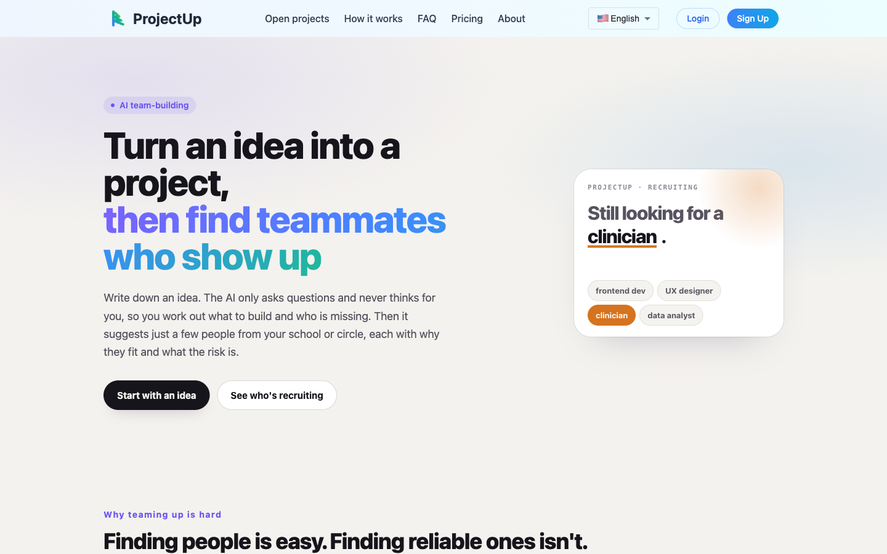
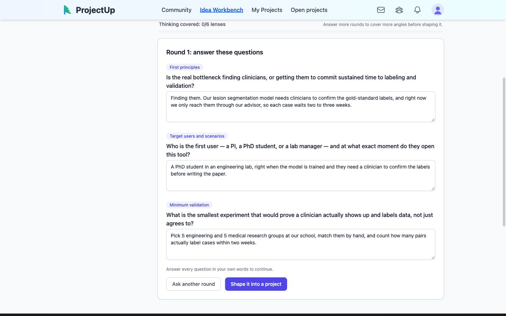
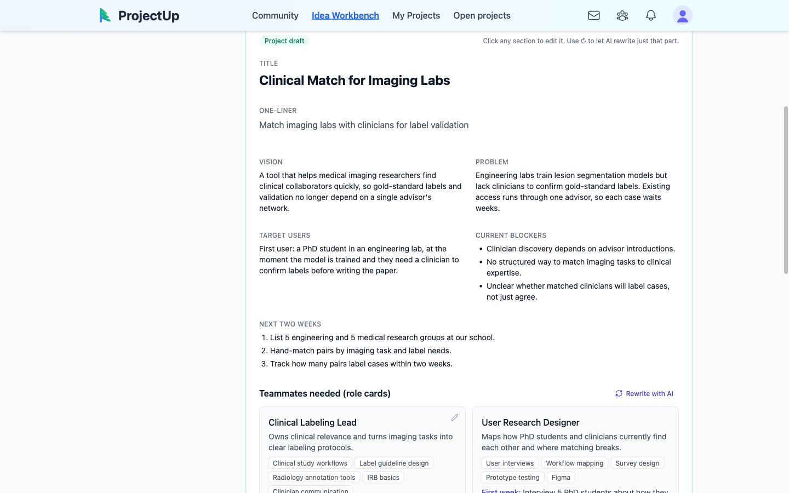
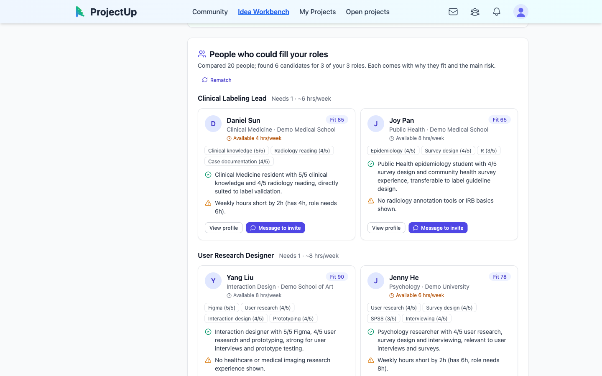
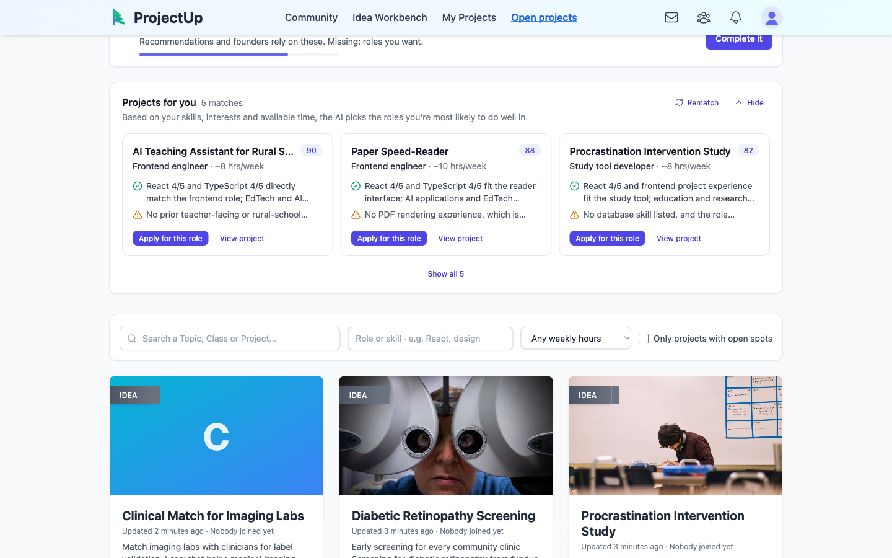
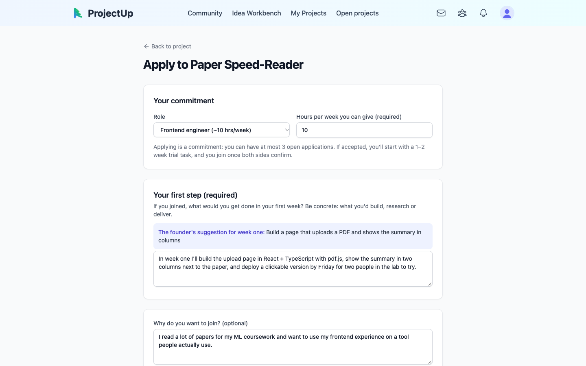
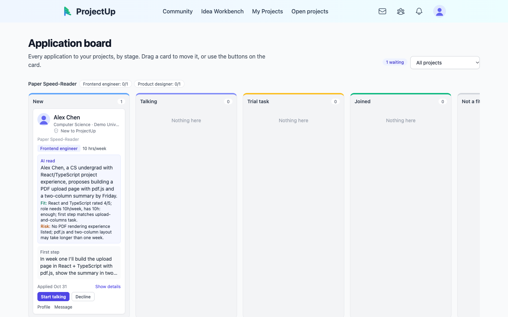

# ProjectUp

[中文](README.zh-CN.md) | **English**

**Turn an idea into a small team that actually gets it done.**

ProjectUp covers the steps where small projects most often fail on the way from 0 to 1: figuring out what to build and who's missing, finding partners who will commit, and keeping the team together after work starts. We start with the hardest step: **forming the team**.

AI helps you break a fuzzy idea into concrete roles, then recommends the few people who can actually fill the project's gaps. Applicants state how many hours a week they can give and what they'll do in their first week, and they do a trial task before joining.

**Built for**: student projects, cross-disciplinary research collaborations, competition and hackathon teams, and early-stage startups looking for co-founders.



---

## The problem

**Finding people isn't hard. Finding reliable people is.** Posts and group chats already get you people, but the most common reason small teams fail is that someone disappears halfway through.

The problem runs through the whole team-building process, not just the "finding people" step:

| Stage | Problem | Why current approaches fall short |
|---|---|---|
| **Before forming** | **The idea is vague; you don't know who you need** | A recruiting post says only "looking for frontend, looking for design". Readers can't tell whether they'd be a fit, and the founder hasn't thought through what to build either. |
| **Finding people** | **You can't find people who fill the gap** | Most channels rely on posts and personal networks, with no matching at all. The ones that do match mostly find "people like you" by tags. But a project needs people who cover its weak spots: an algorithms team needs someone who knows clinical work, not another algorithm writer. |
| **Screening** | **You can't tell who's reliable** | Expressing interest costs nothing. One person can apply to ten projects at once, and every application just says "I'd like to join". Facing a pile of profiles and chat logs, founders go on gut feeling. |
| **After forming** | **People slack off and the team falls apart** | Once someone joins, nobody is clear on how much they'll put in each week. There are no commitments and no records, and vanishing midway costs nothing. |

So ProjectUp isn't trying to have a smarter matching algorithm. It does two things: **match by gap**, which answers "who to look for"; and **turn "claimed interest" into "verifiable commitment"**, which answers "are they reliable". AI is just the means: it asks, organizes and recommends, and people make the calls.

---

## The solution: one path from idea to kickoff

| Stage | Step | How it works in the product |
|---|---|---|
| Before forming | ① Think it through | Each round, AI asks just 3 key questions that you must answer in your own words; AI points out gaps but doesn't think for you |
| Before forming | ② Shape it | One click generates a project brief, current blockers, a two-week plan, and role cards for "who's still missing" (skills, weekly hours, first-week task) |
| Finding people | ③ Two-way, gap-based recommendations | Find people who fill each role card: can they do the role, do they have the time, are their interests relevant; every recommendation states its reasons and main risk |
| Screening | ④ Apply with commitment | Applications must include weekly hours and a "first-step proposal"; each person can have at most 3 pending applications |
| Screening | ⑤ Screen and trial | An application board moves candidates through stages, with an AI quick read of each application; assign a trial task first, and join formally once both sides agree |
| After forming | ⑥ Kick off and keep going | Kickoff checklist, weekly check-ins, decision log; completion records build up into personal reliability, your credibility for the next team |

### ① Think it through: AI asks, you do the thinking

After you write a one-line idea, AI asks 3 questions per round from different angles (target users and scenarios, minimum validation, key assumptions and risks…). You must answer each question in your own words to continue, and you can go one more round so AI digs deeper based on your answers. Drafts save automatically.



### ② Shape it: from idea to project and role cards

Once it's clear, click "Shape this into a project" to generate the vision, the problem to solve, target users, current blockers, a plan for the next two weeks, and role cards for **who's still missing**. Each role card lists the skills needed, roughly how many hours a week, and what to do in the first week after joining. You can edit any section directly, or have AI rewrite just that section.



### ③ Two-way, gap-based recommendations: match the gap, not the similarity

Once a project is public, the system searches role by role against the role cards, looking for people who **can fill that gap**, not people with backgrounds similar to the founder's:
- **Pre-filter**: checks whether a candidate's skills overlap with the role's requirements, whether the roles they want line up, and whether their interests relate to the project's topic, counting adjacent fields too (e.g. "clinical" and "public health");
- **Ranking**: an LLM scores on "can they do this specific role, do they have enough weekly time, are their interests relevant". Whether weekly hours are sufficient is computed by the backend before being passed to the model, so the model doesn't compare numbers wrong;
- **Few but good**: each role gets only a handful of recommendations, each with **why they fit** and **the main risk** (e.g. "can only give 4 hours a week").



People looking for a team see the reverse on the "Recruiting projects" page: which role on which project suits you best, also with reasons and risks.



### ④ Apply with commitment

An application is no longer just "I'd like to join":
- Pick a specific role and **you must enter how many hours a week you can commit**;
- **You must write a "first-step proposal"**: what you plan to deliver in your first week. The founder's suggested first-week task is shown on the page for reference;
- Each person can have at most 3 pending applications at a time, so expressing interest has a cost.



### ⑤ Screen and trial: the application board

Founders handle every application on one board: New → In conversation → On trial → Joined / Declined.
- Each card shows the role, committed hours and first-step proposal at a glance;
- **AI quick read** summarizes each application's fit and risks;
- Moving someone to "On trial" requires a trial task and a due date, and the applicant is notified;
- If an application sits unhandled for 48 hours, the founder gets a reminder.



### ⑥ Kick off and keep going: keep the team together

Once the team is formed, the project overview page offers a kickoff checklist, role gaps with "Reopen recruiting", weekly check-ins and a decision log. How many projects you've joined, how many you've finished, and whether you've written check-ins on time in recent weeks all show up as "Reliability" on your profile, becoming your credibility for the next team.

---

## Common concerns

**Will my idea get copied?**
Ideas are cheap; execution is what counts. Over-protecting makes it harder for the right people to discover your project. A project's creation time is recorded when it's published, which can serve as evidence of who proposed it first. Tiered visibility, where "core details are visible only to accepted applicants", is planned.

**What if popular projects get swamped and niche ones get ignored?**
Each person can have at most 3 pending applications at a time, so popular projects don't get flooded with casual applications. Niche projects don't have to wait: the system recommends people who fill the role cards directly to the founder, who can message them with an invite.

---

## Current limitations

The following are planned but not yet implemented:

- **Tiered visibility**: core ideas visible only to accepted applicants. Today, project briefs are fully public.
- **Team-level complementarity**: "complementary" is currently computed against role cards; it doesn't yet analyze the skill mix of members who've joined to find people who round out the team.
- **Vector retrieval**: matching currently uses skill and interest overlap for pre-filtering plus LLM ranking; pgvector will come once data volume grows.
- **Composite reliability score**: only raw records are shown today (projects joined, projects completed, check-in weeks); they're not yet combined into a score used in ranking.

For background and trade-offs, see [AI project matching strategy](docs/strategy/AI_PROJECT_MATCHING_STRATEGY.md) and [Team-building flow design](docs/features/TEAM_MATCHING_FLOW.md).

---

## Try it out

Requirements: Docker, Go, Node.js, `psql`, and an [OpenRouter](https://openrouter.ai) API key.

```bash
cp demo/openrouter.env.example demo/openrouter.env   # add your OPENROUTER_API_KEY
DEMO_LANG=en ./demo/start.sh                         # first run creates tables and loads English sample data
```

Without `DEMO_LANG=en` the sample people and projects are in Chinese. The English data lives in its own database, so you can keep both.

Open http://localhost:5173 and sign in with a demo account (password for both is `demo1234`):

| Account | Persona | Demonstrates |
|---|---|---|
| `founder@demo.projectup.local` | Founder: 2nd-year biomedical engineering master's student | Idea workspace → shaping → recommended candidates → application board |
| `seeker@demo.projectup.local` | Team seeker: 3rd-year CS undergrad who knows React | Projects recommended to you → applying with commitment |

The database, Redis and file storage all run in local Docker and never connect to any live resources. For the full 5-minute demo script, see [demo/README.md](demo/README.md).

---

## Architecture

```
ProjectUp/
├── frontend/     # React + TypeScript + Vite, Tailwind, Redux Toolkit
├── backend/      # Go + Gin + GORM, PostgreSQL, Redis; idea shaping and matching live here (via OpenRouter)
├── ai-service/   # Python + FastAPI + LangGraph: node chat, RAG, roadmaps and other earlier AI features
├── demo/         # One-command local demo environment (Postgres, Redis, MinIO, sample data)
├── deployment/   # systemd, nginx and deployment scripts
└── docs/         # Architecture, feature design, how-to guides and product strategy
```

The team-building flow (idea workspace, recommendations, applications, board) needs only frontend and backend; it doesn't depend on ai-service.

**Start each service separately** (against your own database):

```bash
cd backend && cp .env.example .env && go run main.go               # :8080, Swagger at /swagger/index.html
cd frontend && cp .env.example .env && npm install && npm run dev  # :5173
cd ai-service && cp .env.example .env && pip install -r requirements.txt && python main.py serve --reload   # :8000
```

See each service's `.env.example` for the environment variables it needs. For production deployment, see the [Deployment guide](docs/architecture/DEPLOYMENT.md); for all docs, see [docs/README.md](docs/README.md).
