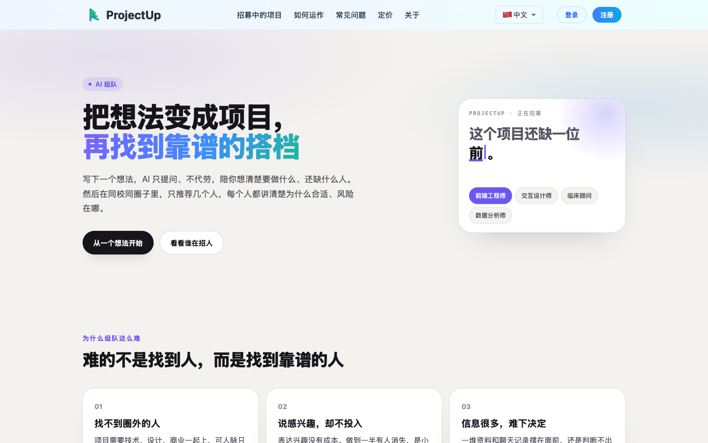
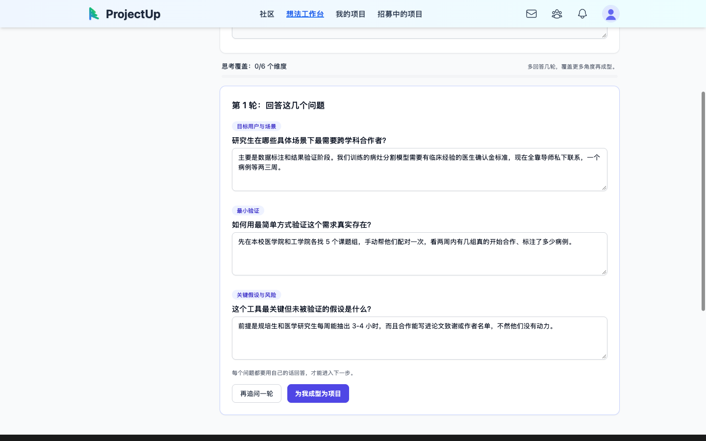
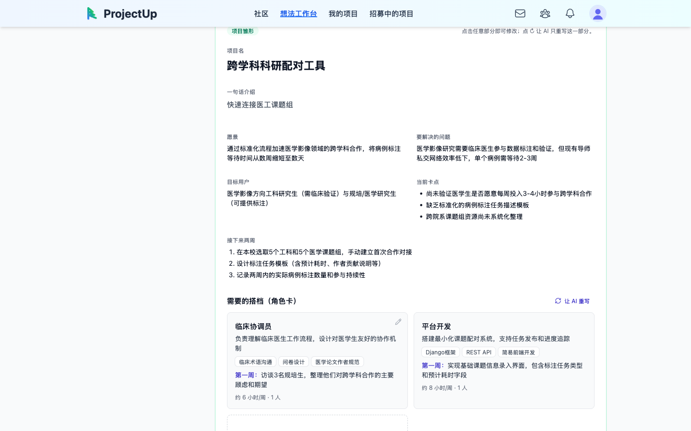
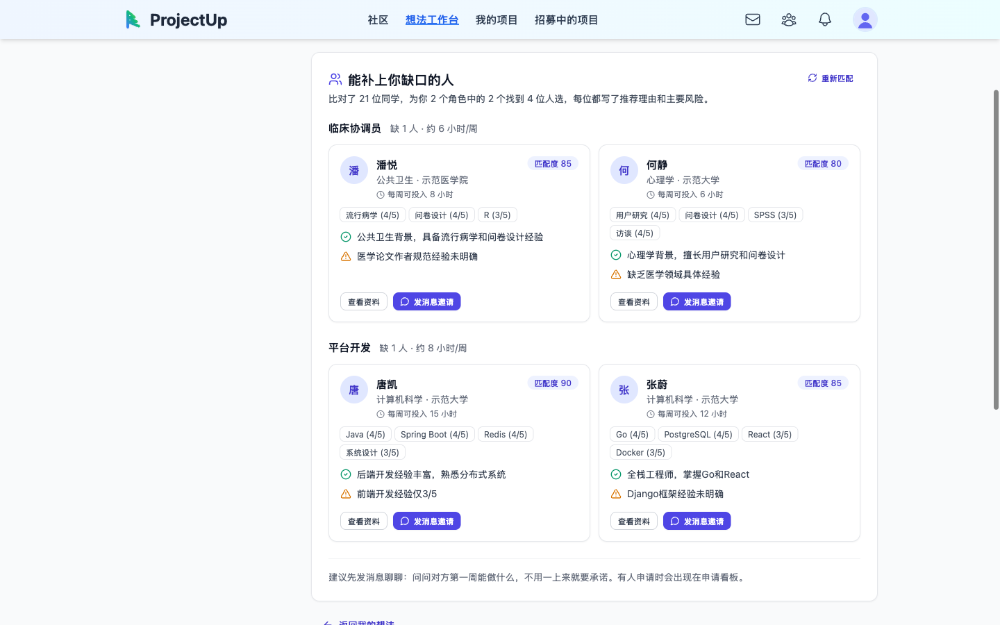
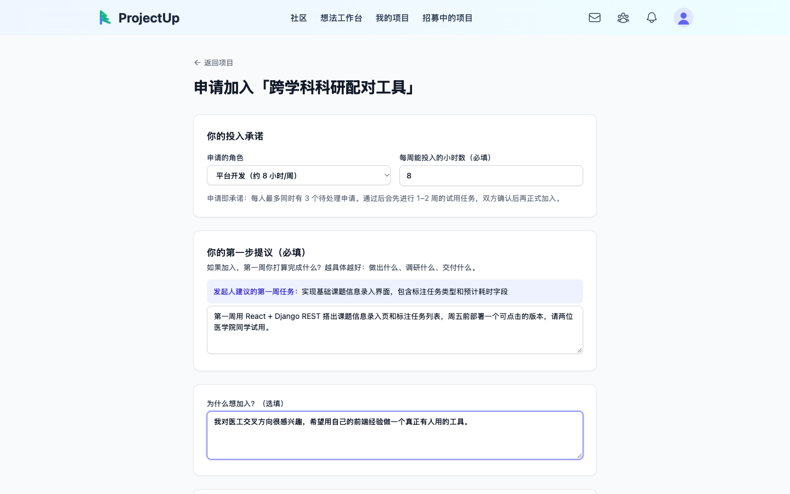
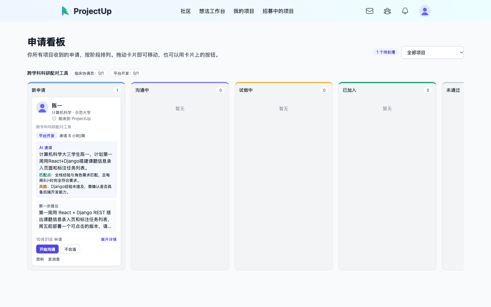

# ProjectUp

**中文** | [English](README.md)

**帮你把一个想法，变成一支能把事情做成的小队。**

ProjectUp 覆盖一个小项目从 0 到 1 最容易失败的几个环节：想清楚要做什么、缺什么人，找到肯投入的搭档，再到开工后团队不散。我们从最难的一步切入：**组队**。

AI 陪你把模糊的想法拆成具体的角色，再按项目的缺口推荐少数几个真正能补位的人。申请时要写明每周投入多少时间、第一周做什么，加入前先试做一段时间。

**适合**：学生项目、课题组跨学科合作、比赛与黑客松组队，以及早期创业找合伙人。



---

## 我们要解决的问题

**难的不是找到人，而是找到靠谱的人。** 发帖、拉群已经能找到人，但小团队失败最常见的原因，是有人做到一半就消失了。

问题贯穿组队的整个过程，不只发生在"找人"这一步：

| 阶段 | 问题 | 现在的做法为什么不行 |
|---|---|---|
| **组队前** | **想法说不清，不知道缺什么人** | 招募帖只有一句"招前端、招设计"，看帖的人判断不了自己能不能胜任，发起人自己也没想清楚要做什么。 |
| **找人时** | **找不到能补位的人** | 大多数渠道靠发帖和人脉，根本没有匹配；做了匹配的，也多是按标签找"和你像的人"。可项目缺的是能补上短板的人：做算法的团队缺懂临床的，而不是另一个写算法的。 |
| **筛选时** | **判断不了谁靠谱** | 表达兴趣没有成本，一个人可以同时报十个项目，申请都只写"我想加入"。发起人面对一堆资料和聊天记录，只能靠感觉。 |
| **组队后** | **有人摸鱼，团队中途散掉** | 加入以后每周投入多少没人说得清，没有约束也没有记录，中途消失也没有代价。 |

所以 ProjectUp 不比谁的匹配算法更聪明，而是做两件事：**按缺口找人**，回答"找谁"；**把"声称感兴趣"变成"可验证的投入"**，回答"靠不靠谱"。AI 只是手段：它负责提问、整理和推荐，判断交给人来做。

---

## 解决方案：一条从想法到开工的主线

| 阶段 | 步骤 | 产品里怎么做 |
|---|---|---|
| 组队前 | ① 想清楚 | AI 每轮只问 3 个关键问题，必须用自己的话回答；AI 指出漏洞，但不替你想 |
| 组队前 | ② 成型 | 一键生成项目简介、当前卡点、两周计划，以及"还缺哪些人"的角色卡（技能、每周时长、第一周任务） |
| 找人时 | ③ 按缺口双向推荐 | 按角色卡找能补位的人：能否胜任这个角色、时间够不够、兴趣是否相关；每条推荐都写明理由和主要风险 |
| 筛选时 | ④ 带承诺地申请 | 申请必须填每周投入时长和"第一步提议"；每人同时最多 3 个待处理申请 |
| 筛选时 | ⑤ 筛选与试做 | 申请看板分阶段推进，AI 速读每份申请；先派试做任务，双方确认后再正式加入 |
| 组队后 | ⑥ 开工与持续 | 开工清单、每周 check-in、决策记录；完成记录沉淀为个人可靠度，成为下次组队的信誉 |

### ① 想清楚：AI 只提问，思考由你完成

写下一句话想法后，AI 每轮从不同角度（目标用户与场景、最小验证、关键假设与风险……）提 3 个问题。每个问题都要用自己的话回答才能继续，可以再追问一轮，让 AI 根据你的回答继续深挖。草稿自动保存。



### ② 成型：从想法到项目和角色卡

想清楚以后，点"为我成型为项目"，生成愿景、要解决的问题、目标用户、当前卡点、接下来两周的计划，以及**还缺哪些人**的角色卡。每张角色卡写明需要的技能、每周大约投入几小时，以及加入后第一周要做什么。每一段都可以直接修改，或者只让 AI 重写这一段。



### ③ 按缺口双向推荐：匹配的是缺口，不是相似度

项目公开后，系统按角色卡逐个角色找人，找的是**能补上这个缺口**的人，而不是和发起人背景相似的人：
- **初筛**：看候选人的技能和角色要求是否重叠、想担任的角色是否对得上、兴趣和项目主题是否相关，相近的领域也会算进来（比如"临床"和"公共卫生"）；
- **精排**：大模型按"能否胜任这个具体角色、每周时间够不够、兴趣是否相关"打分。每周时长是否够用由后端先算好再交给模型，避免模型比错数字；
- **少而精**：每个角色只推荐几个人，每人附上**为什么合适**和**主要风险**（比如"每周只能投入 4 小时"）。



求组队的人在"招募中的项目"页看到的是反过来的推荐：哪个项目的哪个角色最适合你，同样附带理由和风险。


### ④ 带承诺地申请

申请不再只是一句"我想加入"：
- 选定具体角色，**必须填写每周能投入的小时数**；
- **必须写"第一步提议"**：加入后第一周打算做出什么。页面上会显示发起人建议的第一周任务作为参考；
- 每人最多同时有 3 个待处理申请，表达兴趣有了成本。



### ⑤ 筛选与试做：申请看板

发起人在一个看板里处理所有申请：新申请 → 沟通中 → 试做中 → 已加入 / 未通过。
- 每张卡片直接显示角色、承诺时长和第一步提议；
- **AI 速读**会总结每份申请的匹配点和风险；
- 移到"试做中"时要填试做任务和截止日期，对方会收到通知；
- 申请 48 小时没人处理时，会提醒发起人。



### ⑥ 开工与持续：让团队不散

团队组好后，项目概览页提供开工清单、角色缺口和"重新开放招募"、每周 check-in 和决策记录。加入了几个项目、完成了几个、最近几周有没有按时写 check-in，这些记录会显示在个人资料的"可靠度"里，成为下一次组队的信誉。

---

## 常见顾虑

**我的 idea 会不会被抄？**
想法本身不值钱，执行才值钱；过度保护反而会让合适的人发现不了你的项目。项目发布时会记录创建时间，可以作为谁先提出的依据。"核心细节只对通过申请的人可见"的分层公开在规划中。

**热门项目被挤爆、冷门项目没人理怎么办？**
每人同时最多挂 3 个待处理申请，热门项目不会被随手的申请刷屏。冷门项目不用干等：系统会按角色卡把能补位的人直接推荐给发起人，由发起人发消息邀请。

---

## 目前的边界

以下内容在规划中，还没有实现：

- **分层公开**：核心想法只对通过申请的人可见。现在项目简介是全部公开的。
- **团队层面的互补分析**：现在的"互补"是相对角色卡计算的，还不会分析已加入成员的技能组合，再去找能补全团队的人。
- **向量召回**：匹配现在用技能和兴趣重叠初筛加 LLM 精排，数据量大了以后再接 pgvector。
- **综合可靠度分**：现在只展示原始记录（加入数、完成数、check-in 周数），还没有合成一个分数参与排序。

背景和取舍见 [AI 项目匹配策略](docs/strategy/AI_PROJECT_MATCHING_STRATEGY.md) 和 [组队主线设计](docs/features/TEAM_MATCHING_FLOW.md)。

---

## 快速体验

需要：Docker、Go、Node.js、`psql`，以及一个 [OpenRouter](https://openrouter.ai) API key。

```bash
cp demo/openrouter.env.example demo/openrouter.env   # 填入 OPENROUTER_API_KEY
./demo/start.sh                                      # 第一次会自动建表并灌入示例数据
```

打开 http://localhost:5173，用演示账号登录（密码都是 `demo1234`）：

| 账号 | 身份 | 用来演示 |
|---|---|---|
| `founder@demo.projectup.local` | 发起人：生物医学工程研二 | 想法工作台 → 成型 → 推荐候选人 → 申请看板 |
| `seeker@demo.projectup.local` | 求组队：计算机大三，会 React | 推荐给你的项目 → 带承诺地申请 |

数据库、Redis 和文件存储都跑在本地 Docker 里，不会连接任何线上资源。完整的 5 分钟演示脚本见 [demo/README.md](demo/README.md)。

---

## 技术架构

```
ProjectUp/
├── frontend/     # React + TypeScript + Vite，Tailwind，Redux Toolkit
├── backend/      # Go + Gin + GORM，PostgreSQL，Redis；想法成型与匹配都在这里（调用 OpenRouter）
├── ai-service/   # Python + FastAPI + LangGraph：节点对话、RAG、路线图等较早的 AI 能力
├── demo/         # 本地一键演示环境（Postgres、Redis、MinIO、示例数据）
├── deployment/   # systemd、nginx 和部署脚本
└── docs/         # 架构、功能设计、操作指南和产品策略
```

组队主线（想法工作台、推荐、申请、看板）只需要 frontend 和 backend，不依赖 ai-service。

**分别启动各服务**（连接你自己的数据库）：

```bash
cd backend && cp .env.example .env && go run main.go               # :8080，Swagger 在 /swagger/index.html
cd frontend && cp .env.example .env && npm install && npm run dev  # :5173
cd ai-service && cp .env.example .env && pip install -r requirements.txt && python main.py serve --reload   # :8000
```

各服务需要的环境变量见各自的 `.env.example`。生产部署见 [部署指南](docs/architecture/DEPLOYMENT.md)，全部文档见 [docs/README.md](docs/README.md)。
